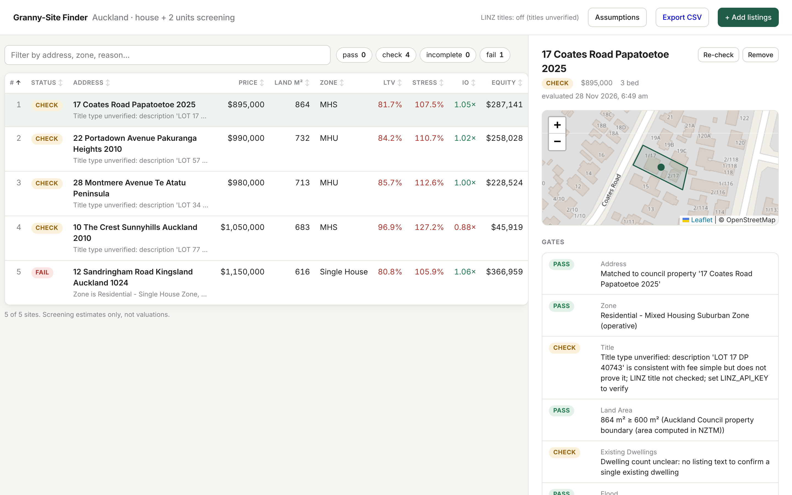

# Granny-Site Finder

Screens Auckland houses for a **house + 2 transportable units** strategy. Given listing addresses it
qualifies each site (zone, title, land, overlays, flood), runs an instant feasibility with stress
cases, and produces a ranked shortlist (web UI, CSV, markdown).

> All valuation outputs are **screening estimates, not valuations**. Every report prints its assumptions.



## Setup

Python 3.11+ (built and tested on 3.13). No GIS libraries needed.

```bash
cd granny-site-finder
python3 -m venv .venv && source .venv/bin/activate
pip install -r requirements.txt
cp .env.example .env          # optional: add LINZ_API_KEY (strongly recommended, see below)
python -m pytest              # 77 offline tests
```

## Run

```bash
# Web UI (http://127.0.0.1:8000): add listings, sort/filter, map, live feaso, CSV export
python -m gsf.cli serve

# Paste addresses (args or stdin). Optional pipe fields: address | price | bedrooms | existing dwellings | notes
python -m gsf.cli paste "17 Coates Road, Papatoetoe | 895000 | 3 | 1" "28 Montmere Ave, Te Atatu Peninsula"
pbpaste | python -m gsf.cli paste

python -m gsf.cli import listings.csv   # CSV import (see tests/fixtures/sample_listings.csv)
python -m gsf.cli rerun                 # re-evaluate everything (e.g. after changing config.yaml)
python -m gsf.cli report                # write data/reports/shortlist-<stamp>.{md,csv}
python -m gsf.cli daily listings.csv    # import + report, for cron
GSF_LIVE=1 python -m pytest tests/test_acceptance_live.py   # 21 real addresses against live data (~2 min)
```

Daily cron example: `40 7 * * * cd /path/granny-site-finder && .venv/bin/python -m gsf.cli daily inbox.csv`

CSV columns: `address` (required), `price`, `price_text`, `bedrooms`, `bathrooms`, `land_area_m2`,
`property_type`, `listing_date`, `url`, `description`, `existing_dwellings`, `listing_id`,
`existing_rent_override`, `unit_rent_override`. Prices like "Enquiries over $900k" are parsed and
flagged as indicative; "Auction"/"Tender" give no price, so the site shows **incomplete**.

## How it works

```
ListingSource (paste | CSV | Trade Me API stub)
  -> council property lookup (address -> boundary, legal description, title refs)
  -> area/shape computed in NZTM; "likely building area" = parcel scaled 60% about an interior point
  -> zone (operative AUP), flood layers, overlays, road frontage, RUB, PC120   [Auckland Council ArcGIS]
  -> title type + building outlines                                           [LINZ, if key set]   
  -> SA2 -> rents (Tenancy Services bond data)                                [Stats NZ + Tenancy Services]
  -> gates (pass / fail / check / incomplete + soft flags, each with a one-line reason)
  -> feaso (base + 4 single stresses + combined worst case)
  -> SQLite (upsert, no duplicates) -> UI / CSV / markdown
```

**Statuses.** `fail` = a hard gate failed on evidence. `check` = a hard gate could not be verified;
the tool never guesses a pass. `incomplete` = an input is missing, such as the price. `pass` = every
hard gate passed on verified data. Soft flags never reject.

Code map: `gsf/feaso.py` (maths), `gsf/gates.py`, `gsf/titles.py`, `gsf/pipeline.py`,
`gsf/lookups/{council,linz,rents,http}.py`, `gsf/sources/`, `gsf/api.py`, `web/index.html`.

## Data sources (verified 2026-11-28)

| Purpose | Source | Status |
|---|---|---|
| Address → property boundary, legal description, title refs | Auckland Council `AC_Property_Query` (ArcGIS, org `n4yPwebTjJCmXB6W`) | Verified, run on 60+ real addresses |
| Zone | `Unitary_Plan_Base_Zone` (filtered to `VERSIONSTATUS=4` operative; ZONE codes decoded from layer domain) | Verified |
| Flood | `Flood_Plains`, `Flood_Prone_Areas`, `Overland_Flow_Paths`, `Flood_Sensitive_Areas` | Verified |
| Overlays | `Historic_Heritage_Overlay_Extent_of_Place`, `…_Place`, `Significant_Ecological_Areas_Overlay`, `Sites_and_Places_of_Significance_to_Mana_Whenua_Overlay`, `Special_Character_Areas_Overlay_Residential_and_Business`, `Regionally_Significant_Volcanic_Viewshafts_And_Height_Sensitive_Areas_Overlay`, `Locally_Significant_Volcanic_Viewshafts_Overlay`, `Notable_Trees_Overlay` | Verified |
| Other | `Rural_Urban_Boundary`, `PC120Revised_PROD_PropertySummary` (proposed zones) | Verified |
| SA2 | Stats NZ `Census2018_dwellings_counts_by_SA2` (bond Location Ids match SA2 2018: 1623/1627) | Verified |
| Rents | Tenancy Services detailed quarterly bond CSV (SA2 × dwelling type × beds, LQ/median/UQ) | Verified; auto-refreshed monthly |
| Title type, building outlines | LINZ LDS vector query API, layers 50804 (Titles) and 101290 (Building Outlines); key sent as `Authorization: key …` | Verified live on 22 addresses (needs `LINZ_API_KEY`) |
| Market Rent API | api.business.govt.nz | **Not implemented**: needs a subscription key; schema unverified |
| Trade Me | Property API | **Stub only.** Never scrapes trademe.co.nz |

## Config reference (`config.yaml`)

All thresholds live here. Secrets go in `.env`. After editing, run `gsf rerun`. Lookups are cached,
so a re-run is fast.

| Key | Default | Meaning |
|---|---|---|
| `gates.allowed_zones` | MHS, MHU | Operative AUP base zones that pass |
| `gates.min_land_m2` | 600 | MIN_LAND_M2 |
| `gates.max_price` | 1,200,000 | MAX_PRICE: **set your own** |
| `gates.required_existing_dwellings` | 1 | |
| `gates.building_core_scale` | 0.6 | Likely building area = parcel scaled about its interior point. Hits only outside it are `partial` (soft flag) |
| `gates.overlays.<layer>` | block / flag | Heritage, SEA and mana whenua block; special character, viewshafts and notable trees flag |
| `gates.flood_layers` | plain, prone, OLFP | Any hit on the building core fails |
| `gates.overland_flow_min_catchment_group` | 1 | 1 = every mapped OLFP (≥2000 m² catchment); 2 = ignore 2000–4000 m² catchments; etc. |
| `gates.road_frontage_tolerance_m` / `narrow_site_width_m` / `rub_proximity_m` | 1.5 / 15 / 200 | Soft-flag thresholds |
| `feaso.*` | spec defaults | `interest_rate` 0.07, `cap_months` 6, `draw_factor` 1.0, `target_yield` 0.06, `yield_basis` gross, `opex_ratio` 0.25, `ltv_cap` 0.65, `units` 2, `unit_cost_installed` 150000, `misc` 40000 |
| `feaso.stress` | −15% rent, +10% dev cost, 6.5% yield, 8% rate | Applied individually and combined; worst case reported |
| `rents.unit_rent_stat` / `existing_rent_stat` | median | `lower_quartile` for conservative |
| `rents.min_bonds` | 10 | Minimum bonds for a cell to be used |
| `rents.pool_quarters` / `neighbour_radius_m` | 4 / 1500 | Fallbacks when the SA2 is thin (see below) |
| `rents.existing_dwelling_types` / `unit_dwelling_types` | [House, ALL] / [House, Flat, ALL] | Tried in order |
| `http.*` | | Timeouts, retries, backoff, per-host rate limit, cache days per source |

**Rent fallback order.** For each dwelling type in order: (1) this SA2 in the latest quarter, then
(2) this SA2 over the last 4 quarters, then (3) all SA2s within 1.5 km over the last 4 quarters. Pooled
values are a bond-weighted mean of the quarterly statistic, not a true pooled median. The rent source,
period and bond count are shown on every site. A manual rent override per site is available in the UI
or CSV.

## Known limitations

- **Set `LINZ_API_KEY`.** Without it, freehold-looking sites stay `check`. The council legal
  description misses many cross-leases: 17 Coates Rd and 22 Portadown Ave show a plain "LOT n DP…" but
  LINZ says cross-lease. The key needs the "Full access to tables and layers' data" scope.
- **Existing dwelling count** comes from listing text or your entry only. Absence of keywords is
  `check`, not `pass`. LINZ building outlines (with a key) add a flag when there are more than 1
  building over 30 m².
- **"Likely building area"** is a geometric proxy (central 60%). It doesn't know where the house sits.
  An OLFP through the middle fails even if the rear is clear. Use the map and the council viewer.
- **Land area** comes from the council boundary computed in NZTM. It is not the title's survey area. For
  cross-leases it is the whole shared lot.
- Not assessed: **slope**, easements, covenants (including retirement-village), access width, building
  coverage, height-in-relation-to-boundary, infrastructure capacity. These show as manual-check flags.
- **Planning rules:** the "3 dwellings per site" permitted standard in MHS/MHU must be confirmed against
  the current AUP text. PC120 is shown for information only; it is undecided (decision expected
  mid-2027). The national granny-flat NES (from 15 Jan 2026) allows **one** ≤70 m² unit per site
  without resource consent, so the second unit still relies on the AUP.
- Gmail alert parser and email notifications (spec build steps 4 and 6) are not built. `gsf daily` +
  cron covers scheduling.
- Overall status ranks on gates. Feaso LTV/IO pass/fail is shown and used for ordering but does not
  change the status.
- The web UI has no auth: it binds to 127.0.0.1. Don't expose it.
